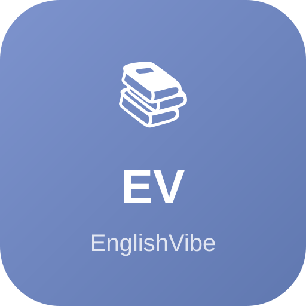

# 📚 EnglishVibe - 初中英语单词学习助手

<p align="center">
  
</p>

<p align="center">
  <strong>让背单词变得轻松有趣！</strong>
</p>

<p align="center">
  <a href="#功能特点">功能特点</a> •
  <a href="#在线体验">在线体验</a> •
  <a href="#快速开始">快速开始</a> •
  <a href="#安装到手机">安装到手机</a>
</p>

---

## ✨ 功能特点

### 🎯 专为初中生设计
- **2276个精选词汇** - 覆盖初一、初二、初三全部核心词汇
- **严格筛选** - 不含小学词汇，专注初中阶段
- **例句辅助** - 每个单词配套例句，理解更深刻

### 🔊 高品质发音
- **有道词典真人发音** - 清晰标准的单词发音
- **例句朗读** - 使用毛球学堂的语音能力
- **单词读两遍** - 间隔250ms，加深印象

### 📅 科学记忆
- **每日目标** - 可选 20/30/50/100 个新单词
- **间隔复习** - 1天、3天、7天科学复习（艾宾浩斯曲线）
- **进度追踪** - 实时显示学习统计
- **分阶段学习** - 按七年级上→下→八年级上→下→九年级上→下顺序
- **随机选词** - 每阶段内随机选取，避免枯燥

### 📱 PWA 支持
- **安装到手机** - 像原生 App 一样使用
- **离线可用** - 无需网络也能学习（发音除外）
- **跨平台** - Android、iOS、电脑、平板都能用
- **响应式设计** - 完美适配手机、平板横屏/竖屏

---

## 🌐 在线体验

| 平台 | 地址 | 说明 |
|------|------|------|
| **GitHub Pages** | [shentuyangguang1985-oss.github.io/EnglishVibe](https://shentuyangguang1985-oss.github.io/EnglishVibe/) | ⭐ **推荐** |
| **Vercel** | [english-vibe.vercel.app](https://english-vibe.vercel.app) | 备用地址 |
| **Cloudflare** | [englishvibe.shentuyangguang1985.workers.dev](https://englishvibe.shentuyangguang1985.workers.dev) | 备用地址 |

> 💡 **推荐使用 GitHub Pages 地址**，免费稳定！

---

## 🚀 快速开始

### 本地运行

```bash
# 克隆项目
git clone https://github.com/shentuyangguang1985-oss/EnglishVibe.git

# 进入目录
cd EnglishVibe

# 启动本地服务器（任选一种）
python3 -m http.server 8080
# 或
npx serve . -p 8080

# 打开浏览器访问
open http://localhost:8080
```

### 项目结构

```
EnglishVibe/
├── index.html          # 首页
├── learn.html          # 学习页面
├── review.html         # 复习页面
├── settings.html       # 设置页面
├── complete.html       # 完成页面
├── css/
│   └── style.css       # 样式文件（含响应式适配）
├── js/
│   ├── app.js          # 主应用逻辑
│   ├── audio.js        # 音频模块（有道API）
│   ├── learn.js        # 学习逻辑
│   ├── review.js       # 复习逻辑
│   ├── storage.js      # 存储模块（localStorage）
│   ├── vocabulary.js   # 词库管理
│   └── sentence-tts.js    # 例句发音客户端
├── data/               # 词库数据 (JSON)
├── assets/             # 图标资源
├── manifest.json       # PWA 配置
├── wrangler.jsonc      # Cloudflare Worker 配置
└── sw.js               # Service Worker
```

---

## 📲 安装到手机

### Android 手机

1. 用 **Chrome** 打开在线地址
2. 点击右上角 **⋮** 菜单
3. 选择 **"添加到主屏幕"** 或 **"安装应用"**
4. 确认安装

### iPhone / iPad

1. 用 **Safari** 打开在线地址（必须是Safari！）
2. 点击底部 **分享** 按钮 ⬆️
3. 选择 **"添加到主屏幕"**
4. 点击 **"添加"**

> 📖 详细指南请参考 [PWA安装指南.md](PWA安装指南.md)

---

## 📖 使用指南

### 学习流程

1. **开始学习** - 点击首页"开始学习"按钮
2. **分阶段进行** - 首页显示当前学习阶段（如"七年级上"）
3. **听发音** - 系统自动播放单词发音（读2遍）
4. **选答案** - 根据发音选择正确的中文释义
5. **看例句** - 答题后显示例句，点击🔊可听例句发音
6. **点击下一个** - 继续学习下一个单词
7. **继续学习** - 完成今日目标后可继续学习更多
8. **自动进阶** - 当前阶段学完后自动进入下一阶段

### 复习机制

- 学过的单词会自动进入复习队列
- 按照 **1天、3天、7天** 的间隔复习
- 答错的单词会重新加入学习

### 设置选项

- **每日目标** - 20/30/50/100词可选
- **清除数据** - 重置所有学习进度

---

## 🛠️ 技术栈

| 模块 | 技术 |
|------|------|
| 前端 | 纯 HTML5 + CSS3 + Vanilla JavaScript |
| 单词发音 | 有道词典 API |
| 例句发音 | 毛球学堂语音服务 |
| 存储 | LocalStorage |
| PWA | Service Worker + Web App Manifest |
| 部署 | Cloudflare Pages / Vercel |

---

## 📊 词库来源

- 外研版《新标准英语》初中教材
- 人教版初中英语教材
- 合并去重，严格筛选初中阶段词汇（不含小学词汇）
- 共计 **2276个** 核心词汇

---

## 📋 相关文档

- [PWA安装指南.md](PWA安装指南.md) - 详细的PWA安装说明
- [问题解决指南.md](问题解决指南.md) - 常见问题与解决方案

---

## 🙏 致谢

- [有道词典](https://dict.youdao.com) - 提供单词发音
- [毛球学堂](https://shentunotes.com/learn/tutor/) - 提供例句朗读
- [GitHub Pages](https://pages.github.com) - 提供免费托管服务
- [Cloudflare Pages](https://pages.cloudflare.com) - 提供备用托管服务

---

## 🤝 贡献

欢迎提交 Issue 和 Pull Request！

---

## 📄 许可证

MIT License

---

<p align="center">
  Made with ❤️ for 初中生
</p>

## 例句朗读与学习大厅接入

EnglishVibe 向同源的 `api/tts` 请求例句音频。Worker 只接受 `data/vocab_all.json` 内的例句，并按来源 IP 限流，每个 Cloudflare 节点每分钟 20 次。Worker 调用毛球学堂现有的 `POST /learn/tutor/api/speak`，使用学堂服务端配置的语音模型。请求只向学堂发送例句文本。语音服务不可用时，回退到有道逐词发音。

### 接入 shentunotes.com

1. 将 `index.html`、`learn.html`、`review.html`、`settings.html`、`complete.html`、`manifest.json`、`sw.js`、`assets/`、`css/`、`js/` 和 `data/vocab_all.json` 复制到主站的静态构建输出 `learn/englishvibe/`。发布时同步删除旧版 `js/xfyun-tts.js`，并确保目录入口带尾部斜杠。
2. 在主站 `/learn/` 添加「英语单词」入口，链接到 `/learn/englishvibe/`。
3. 在 Cloudflare 给本仓库的 `englishvibe` Worker 配置路由 `shentunotes.com/learn/englishvibe/api/tts*`。Worker 会检查准确的接口路径，页面和静态文件由主站提供。备用 Worker 域名使用 `/api/tts`。
4. 确认毛球学堂线上服务已配置语音，并验证 Worker 发往学堂的请求能返回英语音频。若该接口部署在同 Zone 的另一条 Worker Route 上，用名为 `TUTOR_SPEECH` 的 Service Binding 指向实际学堂 Worker。若学堂接口要求内部身份，在学堂侧配置服务间调用权限。EnglishVibe 浏览器端只调用自己的接口。
5. 上线时分别验证学习页和复习页的有道发音及例句，检查离线能打开学习页和加载词库。旧地址的本机学习进度保留在原域名。新地址从空进度开始，已安装的旧 PWA 需从新地址重新安装。

旧版讯飞凭据已公开，应在讯飞控制台撤销旧 API Key 和 API Secret。如有其他应用仍在使用，给那些应用配置新凭据。EnglishVibe 已切换到毛球学堂，无需录入新的讯飞凭据。Git 历史和旧设备缓存里的副本要以撤销后的凭据失效为准。
